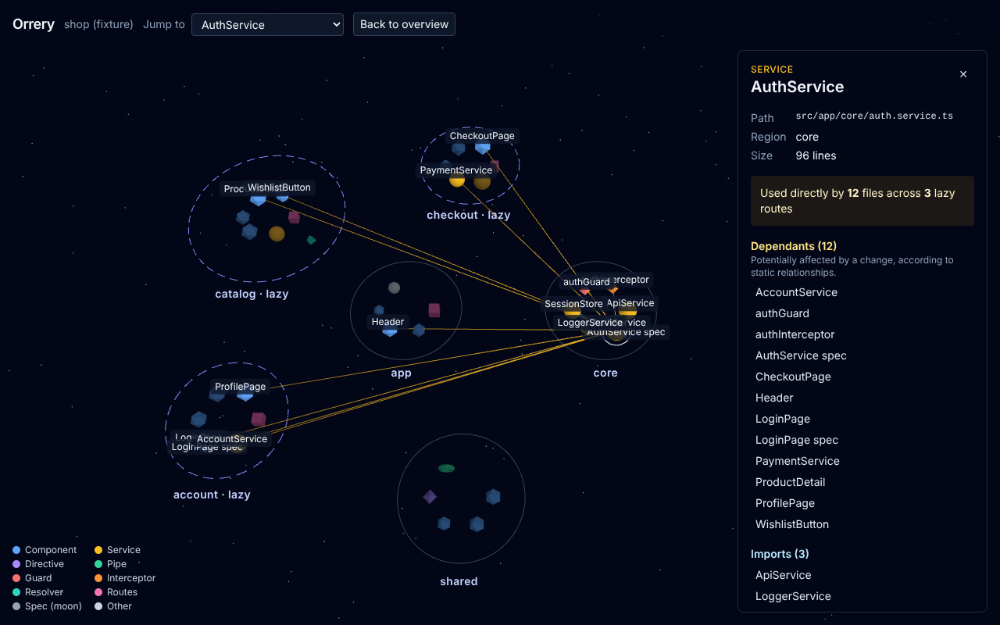

# Orrery

Your Angular app, as a living solar system. Orrery is a visual architecture explorer for Angular applications: lazy routes and feature folders become solar systems, components and services become planets, and their relationships become edges you can follow.

**Live:** https://sunnyside9408.github.io/Orrery/

Status: Phase 1 (app shell and one real sample, the Angular RealWorld app, analysed at build time). Exploring your own folder comes in Phase 2.



## What you can do

- Open the bundled sample and see its lazy routes as dashed rings, its components, services, directives, pipes and interceptors as planets.
- Search (press `/`) or click a planet: the inspector lists what it imports and what depends on it, and the map lights up those files.
- Switch to the **List** view for the same facts as tables, including unresolved imports.
- Links keep the selection (`?node=…`), and the site works offline after the first visit.

Everything is static analysis: "depends on" means a static relationship in the source, not proof that a change will break something.

## Getting started

Requires Node 24 (see `.nvmrc`).

```bash
npm install
npm start          # http://localhost:4200
```

| Command                | What it does                                             |
| ---------------------- | -------------------------------------------------------- |
| `npm run lint`         | ESLint over the whole repo, including package boundaries |
| `npm run typecheck`    | `tsc` for every package and the app                      |
| `npm test`             | Vitest for the packages, then `ng test` for the app      |
| `npm run build`        | Production build of the app into `dist/web`              |
| `npm run format:check` | Prettier check                                           |
| `npm run samples`      | Re-analyse the bundled samples into `apps/web/public`    |
| `npm run e2e`          | Playwright tests against the production build            |

CI runs all of these on every pull request, checks that the app bundle has no TypeScript compiler in it, and checks that the sample JSON matches what the analyser produces. Pushes to `main` deploy to GitHub Pages.

To analyse another Angular project on the command line: `npm run orrery -- analyze <folder> --out result.json`.

## Layout

```
apps/web                   Angular explorer
packages/contracts         analysis-result types, validation, ID rules
packages/analyzer-angular  TypeScript compiler API → analysis result
packages/graph-core        adjacency and dependants (impact, cycles, metrics later)
packages/layout            deterministic orbit layout
tools/cli                  analyses the bundled samples at build time
fixtures/shop              hand-written analysis result: 40 nodes, 3 lazy features (tests)
e2e                        Playwright tests
docs/decisions             architecture decision records
```

See [docs/decisions](docs/decisions) for why it is shaped this way.

## Credits

The bundled sample is the [Angular RealWorld example app](https://github.com/gothinkster/angular-realworld-example-app) (Conduit) by Thinkster and contributors, MIT licence. Orrery ships an analysis of its source, not the source itself.

## License

MIT
