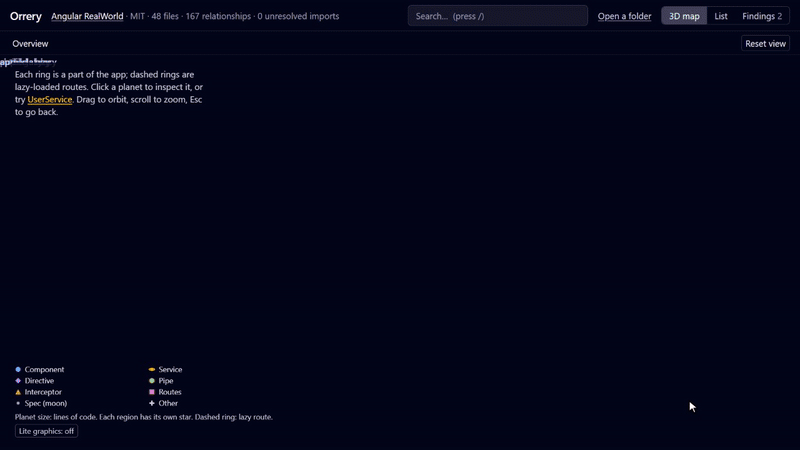
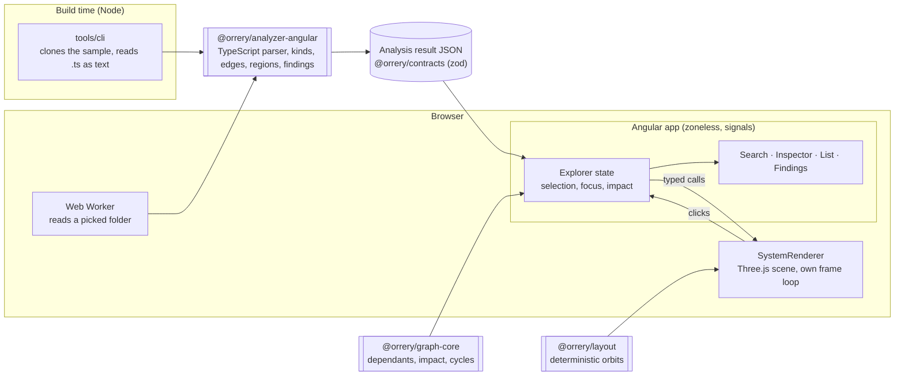

# Orrery

**Your Angular app, as a living solar system.** Orrery reads an Angular codebase and draws it as a 3D map: lazy routes and feature folders become solar systems, components and services become planets, and their relationships become edges you can follow. Click a service and see, across every feature, what depends on it.

**[Open the live demo →](https://sunnyside9408.github.io/Orrery/)**



## Try it in 30 seconds

1. Open the [live demo](https://sunnyside9408.github.io/Orrery/). It loads the [Angular RealWorld](https://github.com/gothinkster/angular-realworld-example-app) app, already analysed.
2. Click **UserService** (or press `/` and type it). The camera glides to it, and every file that uses it lights up across four lazy-loaded features.
3. Press **Show full impact**: everything potentially affected by a change spreads out in waves, each with the path that links it.
4. Open **Findings** for dependency cycles and unusually high fan-in or fan-out, each with its evidence.
5. **Open a folder** to map your own Angular project. It is analysed in your browser; nothing is uploaded.

Or run it locally (Node 24, see `.nvmrc`):

```bash
npm install
npm start          # http://localhost:4200
```

## Why it is not just an import graph

Orrery understands Angular, not only files:

- **Kinds**, from decorators and typed functions imported from `@angular/core`: components, services, directives, pipes, guards, resolvers, interceptors, NgModules and route files. Each kind is its own planet family, with a marker shape so nothing relies on colour alone.
- **Lazy regions.** Every `loadComponent` / `loadChildren` target starts a solar system, and a file belongs to it only if lazy code alone reaches it. A file the eager app also imports is placed where it actually ships.
- **Standalone imports and dependency injection** are edges of their own, next to plain imports: "the template can use it" and "the injector hands it over" are different facts from "the file mentions it". Provider scopes (`root`, component, route…) show as badges.
- **Specs are moons** of the file they test, and stay out of the metrics.

Everything is static analysis and says so: "potentially affected according to static relationships", with unresolved imports counted and listed.

## How it works



- **One analyser, two places.** The same pure function analyses the bundled sample at build time and a visitor's folder in a Web Worker. It parses each file with the TypeScript compiler API and never installs, builds or runs anything.
- **A validated contract.** Every result passes through zod schemas and cross-reference checks before the app sees it. IDs come from file paths, so results are stable and diffable; CI regenerates the sample and fails if it changed.
- **Angular owns meaning, Three.js only draws.** The renderer is a plain class behind a typed interface, runs its own frame loop outside change detection, and is tested with a fake.
- **The compiler never reaches the sample path.** The 800 kB TypeScript compiler loads only in the worker, only when someone picks a folder; a CI check fails the build otherwise. The first screen is 82 kB over the wire.
- **Fast by design.** All planets are one instanced shader (each file's path seeds its own unique planet), labels are pooled, edges stay hidden until focus, and weak GPUs step down to lite graphics. 500 files and 2,000 edges run at 120 fps (the display cap) on the baseline laptop.

## Engineering notes

- **Tests:** unit tests for the analyser, graph algorithms, layout and renderer helpers (Vitest); Playwright end to end for open → search → select → inspect → impact → findings, folder analysis (including a test that fails if any request leaves the machine), offline use, reduced motion, a WCAG 2.2 AA scan of every view, keyboard-only use, and a memory test over 10 project swaps.
- **CI** on every pull request: format, lint (including package boundaries), typecheck, tests, production build, bundle check, end-to-end tests, and a byte-for-byte check of the bundled sample. Every merge to `main` deploys to GitHub Pages.
- **Accessible:** everything the 3D view says, the List view says as tables. Keyboard throughout, visible focus, screen-reader announcements, and `prefers-reduced-motion` turns off every animation (tested).
- **Decisions** are written down, one page each: [docs/decisions](docs/decisions) has a one-line answer for each, from "why Three.js" to "why no backend".

## Limitations

- **Angular only**, and only what static analysis can see: no type checker, so decorator aliases and barrel re-exports of tokens can be missed; template usage outside an `imports` array is not an edge yet.
- **One graph per folder.** A multi-app workspace is analysed as one graph; picking one app's folder reads better.
- **Local folders up to** 5,000 source files, 50 MB in total and 1 MB per file. Results live in the tab and are gone on reload.
- **No GitHub-URL analysis** and no private repositories: there is no backend in version 1, on purpose ([0013](docs/decisions/0013-no-backend.md)).
- The frame rate has been measured on one fast GPU; slower ones rely on the automatic lite mode.

## Commands

| Command                | What it does                                               |
| ---------------------- | ---------------------------------------------------------- |
| `npm start`            | Dev server at http://localhost:4200                        |
| `npm run lint`         | ESLint over the whole repo, including package boundaries   |
| `npm run typecheck`    | `tsc` for every package and the app                        |
| `npm test`             | Vitest for the packages, then `ng test` for the app        |
| `npm run build`        | Production build of the app into `dist/web`                |
| `npm run format:check` | Prettier check                                             |
| `npm run samples`      | Re-analyse the bundled samples into `apps/web/public`      |
| `npm run e2e`          | Playwright tests against the production build              |
| `npm run demo:record`  | Record the README demo against a running app (needs a GPU) |

To analyse a project on the command line: `npm run orrery -- analyze <folder> --out result.json`. Add `?fps` to any map URL for a frame-rate readout, and open `/perf` for a generated 500-file stress map.

## Layout

```
apps/web                   Angular explorer (standalone, zoneless, signals, Tailwind)
packages/contracts         analysis-result schemas, validation, ID rules
packages/analyzer-angular  TypeScript compiler API → analysis result
packages/graph-core        dependants, impact, cycles, fan-in/out
packages/layout            deterministic orbit layout
tools/cli                  analyses the bundled samples at build time
fixtures/shop              hand-written analysis result: 40 nodes, 3 lazy features (tests)
e2e                        Playwright tests; e2e/fixtures/tiny-app is a small project to analyse
docs/decisions             architecture decision records
docs/ROADMAP.md            phases, what each delivered, and the design rules
```

## Credits

The bundled sample is the [Angular RealWorld example app](https://github.com/gothinkster/angular-realworld-example-app) (Conduit) by Thinkster and contributors, MIT licence. Orrery ships an analysis of its source, not the source itself.

## License

MIT
